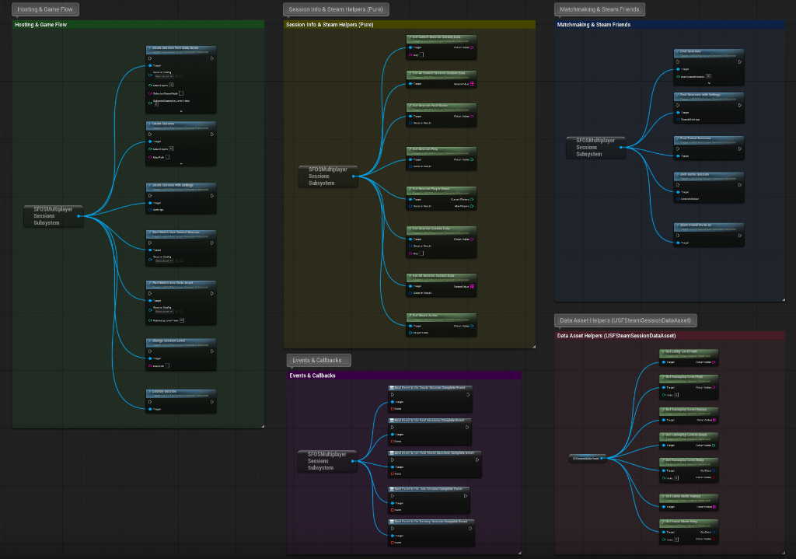

# SF Steam Online Sessions - Overview

**Straight Forward Steam Sessions** is a lightweight, production-ready, and unopinionated Unreal Engine plugin designed to wrap Unreal's Online Subsystem (OSS) and Steam Online Subsystem into a clean, easy-to-use GameInstance Subsystem (`USFOSMultiplayerSessionsSubsystem`).

Built under the **Straight Forward Solid Systems** philosophy, it provides decoupled, modular building blocks: developers can create 1-click frictionless friend lobbies or build advanced server browsers with arbitrary custom metadata without touching C++.

---

## 🎯 Key Features

- 🌐 **Unopinionated & Flexible Hosting:** Host simple 1-click lobbies or pass custom metadata dictionaries (`CustomData`) such as map names, game modes, and custom modifiers.
- 🔍 **Custom Matchmaking & Search Filters:** Filter public sessions using `SearchFilters` or query global Steam lobbies with zero boilerplate.
- 👥 **Steam Friends & Overlay Invites:** Search exclusively for Steam friend games and open the native Steam Overlay friend invitation dialog with 1 click.
- 🖼️ **Steam Player Avatars (GC-Protected):** Fetch player Steam profile pictures directly into `UTexture2D` widgets for custom lobby menus, cached and safe against Garbage Collection.
- 🔄 **Async Event Delegates:** Dynamic multicast delegates for creation, discovery, friend search, joining, and destruction of sessions.
- ✈️ **Clean Server Travel:** Built-in helper to execute seamless server travel with `?listen` for all connected players.
- 🏠 **Automatic LAN Fallback:** if the Steam client is not available, the Online Subsystem falls back to `NULL` and sessions are created and searched as LAN matches (useful for local testing).
- 🛡️ **Zero Bloat & Production Ready:** Zero unnecessary tick, fully event-driven, leak-free RAII memory management, and zero forced workflow restrictions.

---

## 📸 Blueprint API Visual Overview

> [!TIP]
> **Explore Nodes Directly in Unreal Engine:**  
> The entire organized Blueprint node graph pictured above is laid out inside the **Level Blueprint** of the included **`HowToUse`** showcase level (`/StraightForwardOnlineSessions/Levels/HowToUse`). You can open it in the editor to inspect, zoom in, and copy-paste nodes directly into your project.

---

## 📦 Included Example Content

| Asset | Description |
| :--- | :--- |
| `Levels/MenuLevel` | Main menu: host (Data Asset flow), server browser and friend sessions. Default map of the sample project. |
| `Levels/Lobby` | Pre-match lobby with player list, Steam avatars and host-only Start Match. |
| `Levels/GameplayLevel1` / `GameplayLevel2` | Selectable gameplay maps. |
| `Levels/HowToUse` | Documentation room (panels, Docs / Contact buttons) and the node graph in its Level Blueprint. |
| `Bluerpints/Data/SFSession_DataAsset` | Example `USFSteamSessionDataAsset` (lobby, levels, game modes). |
| `Bluerpints/MainMenu`, `Lobby`, `Gameplay` | Game modes, player controllers and characters for each stage. |
| `Widgets/` | `WBP_MainMenu`, `WBP_LobbyUI`, `WBP_GameplayUI`, `WBP_SessionItem`, `WBP_UserList`, `WBP_UserItem`, `WBP_UserName`. |

**Supported engine version:** Unreal Engine 5.8.
